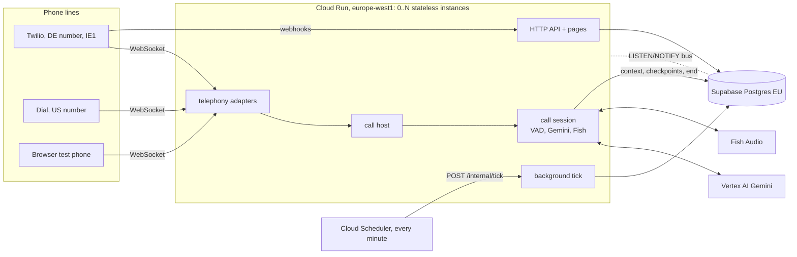

# DesklessOS architecture

A phone line for tradespeople: he calls, talks the way he would to a colleague, and the
call becomes notes, to-dos and a memory of his customers. Max can have the agent ask him
things ("find out X"), in his next call or by calling him. This document is the design as
built after the Cloud Run port (2026-10-13), and the audit that led to it (§12). The phase
plans that got here are in `docs/v2-architecture.md`.

## 1. Requirements

**Functional**
- Inbound calls in German and English: dictate a note, get a briefing, hear what's on.
- Memory across calls: customers, notes, to-dos, the pilot's research findings; searchable.
- Max's requests: an instruction becomes a plan and a card; once he approves it, the question
  is asked in the user's next call or by an outbound call; the answer comes back to him
  (admin page, webhook, email).
- Outbound calls, only to users who agreed, inside their call window, at most N a day.
- Max's own line by phone (drafts requests; approving needs a PIN).
- A monitor: every call's timeline, latency and cost.

**Non-functional**

| | Target | How |
|---|---|---|
| Latency | first audio ≤ 3 s after he stops talking (p50 today 2.4–3.2 s) | streamed Gemini → streamed Fish, hedged requests, nothing slow on the hot path |
| Availability | a call always connects | memory down → the call goes on without it; Gemini slow → backup model |
| Durability | no note lost, even if an instance dies mid-call | the call is saved after every turn; the after-call job is queued in the transaction that ends the call |
| Correctness | nothing done twice (a note, a to-do, a message to Max) | every background step is idempotent; jobs are keyed |
| Data residency | EU | Supabase eu-central-1, Cloud Run europe-west1, Twilio IE1 (open points in §11) |
| Cost | hosting $0 at pilot volume | Cloud Run request-based billing, free tiers (§10) |
| Scale | 1 → ~1,000 users without a redesign | stateless app servers, Postgres as the only state (§8) |

## 2. Capacity estimate

Assumptions: 3 calls a day per user, 4 minutes each, the busiest hour carries 15% of the day.

| | Pilot (1 user) | 1,000 users |
|---|---|---|
| Call minutes a day | ~15 | 12,000 |
| Concurrent calls, busiest hour | 1 | ~30 (1,800 min / 60) |
| Instances (20 calls each, to be load-tested) | 0–1 | 2–3 |
| Audio bandwidth (μ-law, 64 kbit/s each way) | – | ~0.5 MB/s |
| Database writes | – | < 10/s (a checkpoint per turn, ~40 statements per after-call job) |
| Storage a day (transcript ~5 kB, timeline ~100 kB, note ~2 kB per call) | ~0.5 MB | ~320 MB → a retention policy is needed before this scale |
| Gemini + Fish + phone, ~$0.05/min | ~$0.75 | ~$600 |

Hosting is about 1% of the cost at any scale. The first limits are Gemini quota (429s showed
up in testing) and the per-minute bill, not the servers.

## 3. High-level design

A modular monolith: one service, one database. Every instance can take any request, and
Postgres holds everything that outlives a call.



| Component | Files | Responsibility |
|---|---|---|
| Composition root | `server.mjs`, `src/app.mjs`, `src/config.mjs` | builds every part once from validated config; start, drain on SIGTERM |
| Telephony | `src/telephony/{dial,twilio,fake,host}.mjs` | carrier protocols → one frame protocol; signatures; calls on this instance |
| Call wiring | `src/calls/start.mjs` | who's calling, the agenda, the engine, and the call's end |
| Engine | `src/engine/session.mjs` (+ vad, reply, gemini, fish, audio) | the conversation: turn-taking, hedged Gemini stream, Fish, tools, checkpoints |
| Agenda | `src/agenda/*`, `personas/`, `templates/`, `locales/` | what a call is about: persona, capabilities, objectives, prompts, note schema |
| Memory | `src/memory/*` | the data layer: context per call, search, the call row, after-call writes |
| After-call | `src/calls/after-call.mjs` | final note, note saved, objectives, requests, outbound outcome, memory |
| Job queue | `src/jobs/queue.mjs` | all background work, at least once, retried, dead letters |
| Background tick | `src/jobs/background.mjs` | lost calls, due jobs, outbound calls, embeddings |
| Outbound | `src/jobs/scheduler.mjs`, `windows.mjs` | errands, guard (consent, window, cap, on a call), retries |
| Admin | `src/admin/*`, `src/notify.mjs`, `web/admin.html` | login (code + TOTP), planner, cards, approval, notifications |
| Bus | `src/bus.mjs` | messages between instances (Postgres NOTIFY) |
| Monitor | `src/monitor.mjs`, `web/monitor.html` | live timelines (all instances), call log from Postgres |
| HTTP API | `src/http/api.mjs` | one route table with an access level per route |

## 4. Key flows

**An inbound call**

```mermaid
sequenceDiagram
  participant T as Twilio
  participant A as instance A
  participant P as Postgres
  participant B as any instance
  T->>A: POST /twilio/voice (signed)
  A-->>T: TwiML Connect Stream, token
  T->>A: WebSocket /twilio/stream
  A->>P: openCall: who (caller ID), context within 2,500 tokens, objectives
  loop every turn
    A->>A: VAD, Gemini (hedged), Fish, audio out
    A->>P: checkpoint: transcript, latest extraction
  end
  T->>A: stop (hang-up)
  A->>P: one transaction: call ended + job after_call
  A->>B: kick: POST /internal/tick
  B->>P: claim job (SKIP LOCKED)
  B->>B: final note, save, objectives, requests, memory step
  B->>P: done; notify job for Max if a request closed
```

The hot path does only reads at the start and small writes after each turn. Everything
that takes seconds (the final extraction, the memory model) runs after the call, as a job,
on whatever instance has CPU. On Cloud Run, CPU is only allocated while a request is open,
so the job runs inside the tick request, never in the background of a closed one.

**A request from Max:** instruction → planner (Gemini, thinking) → plan and card, plus a
confirm token (HMAC over request id, plan hash and expiry) → approve: an objective for the
user → his next inbound call asks it after his own business, or an outbound errand calls
him → the after-call job records the answer and closes the request → a `notify` job tells Max.

**An outbound call:** the tick lets the scheduler claim one due errand (`FOR UPDATE SKIP
LOCKED`) → guard (consent, pause, number, window in his time zone, one a day, not on a
call on any instance) → Twilio REST with asynchronous answering-machine detection → status
callbacks update the errand. The machine-detection verdict goes out on the bus to whichever
instance holds the stream. The after-call job reports the outcome (done, declined, call
later, voicemail) and the scheduler retries at 30 min, 2 h, then the next day. After four
tries the question moves to his next inbound call and Max is told.

## 5. Data model

All tables carry `org_id` (multi-tenant ready). Row level security is on with no policies:
only the server's service role reads and writes. Schema: `src/db/migrations/001_schema.sql`.

| Table | Holds | Notes |
|---|---|---|
| `orgs`, `users` | tenants and the people who call | `phone_e164` (caller ID → user), consent, call window, time zone |
| `contacts` | his customers | trigram index on name + place (sound-alike search) |
| `calls` | every call with a known caller | transcript and extraction saved per turn; timeline; `consolidated_at`, `after_call_at` guard the after-call steps; `calls_open` index for "on a call" and the lost-call sweep |
| `notes` | his note per call | unique per `call_id` (the after-call job may run twice); pgvector embedding |
| `facts` | what we know, with provenance | never overwritten (`superseded_by`); research findings tagged `area:`/`hyp:`/`stance:` |
| `tasks` | to-dos | open/done, due date, source call |
| `objectives` | what the agent brings to a call | pending → done / expired / cancelled; `calls[]` makes recording idempotent |
| `research_state` | the pilot's question state | |
| `requests` | Max's instructions, plans, cards, results | follows its objective |
| `outbound_calls` | outbound errands and their tries | only ever dials a `users` row |
| `jobs` | the queue | `key` unique (idempotent enqueue), lease, backoff, `dead` |
| `voice_clips` | pre-recorded lines | keyed by hash of model, voice and text |
| `tool_runs` | audit trail of tools that changed something | |

## 6. API

One table in `src/http/api.mjs`; each route has an access level.

| Access | Who | Routes |
|---|---|---|
| public | anyone | `/healthz`, `/api/health`, `/admin` (page), `/api/admin/login`, `/` (test phone page) |
| signed | the carrier | `/twilio/voice`, `/twilio/status`, `/twilio/amd` (Twilio signature); WebSocket `/dial/<id>` (Dial signature) and `/twilio/stream` (our stream token) |
| user | `DEV_TOKEN` or an admin session | `/monitor`, `/api/calls[/:id]`, `/api/memory`, `/api/notes`, `/api/discovery`, `/api/actions/:id`, `/api/config`, WebSocket `/monitor-ws`, test-phone calls |
| admin | an admin session (code + TOTP) | `/api/users`, `/api/requests[...]`, `/api/objectives[...]`, `/api/jobs` |
| tick | `X-Tick-Token` | `POST /internal/tick` |

With neither `DEV_TOKEN` nor `ADMIN_CODE` set (a local run) everything is open; on Cloud
Run the config refuses to start that way.

## 7. Background work

One mechanism for everything that isn't a live call: the `jobs` table plus a tick.

- **Queue semantics:** at least once. A job is claimed with `FOR UPDATE SKIP LOCKED` (any
  number of workers), holds a 5-minute lease, and is retried with backoff (1 min, 5 min,
  30 min, 2 h, 6 h). After 5 tries it's `dead` and shows on the admin page. Enqueueing is
  idempotent by key (`after_call:<call id>`, `notify:<request>:<status>`).
- **Transactional enqueue:** the after-call job is inserted in the same transaction that
  ends the call. There's no window where a call is over but its job is missing (no
  dual-write problem, so no outbox relay needed).
- **Idempotent handlers:** the note is unique per call; the memory step claims the call
  with `update … where consolidated_at is null`; an objective counts a call once; a request
  closes once and its message has its own key.
- **The tick** (`BACKGROUND`): `inline` runs it on a timer in the process (local runs, a VM).
  `http` runs it inside `POST /internal/tick` requests: Cloud Scheduler every minute, and a
  kick from the instance that just ended a call, so the after-call job starts within
  seconds. The minute tick also keeps an instance warm and Supabase from pausing.
- **Lost calls:** a call still open after 30 minutes (calls end at 15) lost its instance.
  The tick ends it and queues its after-call job; the transcript up to its last turn is there.

Why not Cloud Tasks or Pub/Sub: one Postgres already gives transactional enqueue next to the
business write, visibility in SQL, and the same code locally and in tests. Revisit when job
volume or fan-out needs a broker (a workflow engine such as Cloud Workflows or Temporal when
flows branch over days, per `docs/v2-architecture.md`).

## 8. Scaling

- **Stateless instances:** what lives in an instance is only the calls it's carrying (a
  WebSocket can't move anyway), plus caches that can be rebuilt (voice clips, Gemini token).
- **Across instances:**

  | Concern | Solution |
  |---|---|
  | answering-machine verdict on instance A, stream on instance B | bus |
  | "is he on a call?" | `calls` table |
  | live monitor | bus |
  | outbound and jobs | SKIP LOCKED |
  | Dial reconnects | best effort (same instance or the call ends, saved) |
- **Settings:** `--concurrency 20` calls per instance until a load test says otherwise.
  `--max-instances 3` caps cost. Each instance holds a database pool (`DB_POOL`, 4 in
  production) plus one LISTEN connection; instances × 5 stays under the `deskless` login's
  limit of 16 connections.
- **Bottlenecks, in the order they'll bite:**
  1. Gemini quota (ask for more; the hedge already spreads over two models).
  2. Per-minute cost (cheaper carrier, SIP; see below).
  3. Database connections (Supabase compute size, or the transaction pooler for everything except LISTEN).
  4. Timeline storage (retention).
- **When to leave Cloud Run:**
  - own SIP trunks (RTP is UDP: VMs or GKE);
  - self-hosted speech models (GPUs);
  - steady 24/7 load, where always-on VMs get cheaper;
  - in-app WebRTC calls (LiveKit, the plan's revisit point).

## 9. Reliability: failure modes

| Failure | Effect | Handling |
|---|---|---|
| Gemini slow or erroring | a turn stalls | hedge to the backup model after 2.2 s; error line ("oops") after 12 s; jobs retry 429s |
| Gemini quota (429) after the call | after-call job fails | queue retries with backoff; dead after 5, visible |
| Fish down | the agent's own answers can't be spoken | the pre-recorded "sorry" line plays instead; logged. No second voice since Gemini TTS was cut (§11.10) |
| Postgres down at call start | no memory | the call goes on without it, nothing is saved; logged as error |
| Postgres down mid-call | checkpoints fail | logged; the end write retries nothing → the call's after-call is lost (gap, §11) |
| Instance dies mid-call | the call drops | transcript safe up to the last turn; the sweep ends it after 30 min; the after-call job runs |
| Deploy / scale-down (SIGTERM) | calls on that instance end | each call is saved and its job queued within the 10 s Cloud Run gives |
| Duplicate execution (retry, two ticks) | – | idempotent steps, keyed jobs, SKIP LOCKED |
| A tool's side effect twice (false start, hedge) | – | writes wait out the false-start window; tool runs keyed per call |
| Webhook spoofing | – | Twilio and Dial signatures, signed stream tokens |
| Notification provider down | Max isn't told yet | `notify` job retries; dead letter visible on the admin page |

## 10. Deployment and cost

`deploy/cloudrun.sh` (safe to re-run) sets up:

- **Service account:** its own, with `roles/aiplatform.user`. Vertex tokens come from the
  metadata server, so there are no keys.
- **Secrets:** one Secret Manager secret holding `deploy/env.production`, mounted at
  `/secrets/env`. Node reads it with `--env-file-if-exists`. Old versions are destroyed, to stay
  within the free versions (disabled ones would still count).
- **The service:** request-based billing, gen2, 1 vCPU / 1 GiB, 0–3 instances, 60-minute
  request timeout (a call is one WebSocket), startup CPU boost.
- **Cloud Scheduler:** one job that POSTs `/internal/tick` every minute with the tick token.

Cold starts: the server listens at once. Voice clips come from Postgres in one query; on
the first deploy they're synthesised once and cached in `voice_clips`. The minute tick
keeps an instance warm most of the time.

**Cost at pilot volume (estimate):**

| Item | Cost |
|---|---|
| Cloud Run | $0: calls ~15 h a month at 1 vCPU, plus ticks (~43,000 a month at ~0.3 s); the request-based free tier is 180,000 vCPU-s and 2M requests |
| Scheduler | 1 job, inside the free 3 |
| Secret Manager | 1 secret, 1 active version |
| Supabase | free plan (500 MB), shared with the Mano App project (below) |
| Gemini, Fish, Twilio | per minute, as before; Vertex on the Google for Startups credits |

**The database** lives in the Mano App Supabase project (Frankfurt, eu-central-1), because
the free plan allows two active projects per owner and both are in use. It is kept apart
from Mano App:
- **its own schema and login:** `deskless`, which owns only that schema and can't see Mano
  App's tables (`DB_SCHEMA=deskless`);
- **limits:** 16 connections and 30-second statements, so it can't starve Mano App.

The extensions it needs (`vector`, `pg_trgm`, `unaccent`) were enabled once by an admin.
LISTEN/NOTIFY works through the session pooler (tested). Moving it to a project of its own
is a `pg_dump` of the schema.

**Cutover from Fly:**
1. Copy the volume: `fly ssh console -C "tar czf /tmp/data.tgz -C /data ."`, then
   `fly ssh sftp get /tmp/data.tgz`, and unpack it locally.
2. Move it in: `DATA_DIR=<copy> DATABASE_URL=<supabase> node scripts/migrate-json-to-pg.mjs`.
   It's safe to re-run, and checks the counts.
3. Deploy with `deploy/cloudrun.sh`.
4. Point Dial (`npm run dial -- activate wss://…/dial`) and the Twilio number's webhook at
   the new URL.
5. Delete the Fly app.

## 11. Open points, ranked

1. **Vertex quota:** on the first live call `gemini-3.5-flash` answered 429 (resource
   exhausted) and stalled; the backup model carried two of three turns. Ask for a higher
   quota in `mano-games`, or make 2.5 Flash the main model until then.
2. **Load test:** calls per instance before raising concurrency (CPU per call: VAD,
   resampling, Smart Turn when on).
3. **A deploy during a live call:** test what Cloud Run does with an open WebSocket on the
   old revision. Until then, deploy outside call hours.
4. **Data residency:**
   - Vertex runs at `GOOGLE_CLOUD_LOCATION=global`; check whether `gemini-3.5-flash` is
     served from an EU region and pin it.
   - Fish Audio's processing location is unknown.
   - Both belong in the GDPR record.
5. **Retention:** transcripts and timelines are kept forever. Set a period (e.g. 90 days for
   timelines) and a per-user delete.
6. **Own Supabase project:** the database shares the Mano App project (the free plan allows
   two active projects per owner). Move it out (`pg_dump --schema=deskless`) when either app
   needs the room, or when the org goes to Pro.
7. **Tests against real Postgres:** unit and regression tests run on PGlite. The first deploy
   found a difference: postgres.js JSON-encoded jsonb values a second time (fixed in
   `src/db/client.mjs`, with a test). Add a test run against a throwaway Supabase schema.
8. **Alerting:** a log-based alert on `severity>=ERROR` and on dead jobs (Cloud Monitoring, free tier).
9. **Postgres down mid-call:** the call's end write is lost. Keep the final state in the
   job payload, or retry the end write.
10. **Fish has no fallback voice** since Gemini TTS was cut. Accepted for now; a second Fish
   model or voice is the cheap fix.
11. Login lockout counts per instance (in memory); move it to Postgres if more than one
   instance serves the admin page.

## 12. Audit: what changed and why

Before: 7,351 lines of server code in 62 files, a 430-line `server.mjs`, and a 903-line test
page. After: 6,348 lines in 60 files, a 22-line `server.mjs`, and a 609-line test page,
with the queue, after-call job, bus, voice cache, config check and route table added.
Everything removed is at git tag `pre-cloud-run`.

| Finding | Why it mattered | Change |
|---|---|---|
| Two memory backends (JSON files, Postgres) behind `MEMORY_BACKEND` | every feature written and tested twice; Cloud Run has no disk | Postgres only; PGlite (Postgres in-process) for local runs and tests |
| State on the instance: call log and recordings as files, calendar and quotes as JSON, runtime mode switch in memory | lost on restart; wrong with two instances | all in Postgres or config; recordings only locally (`RECORD_CALLS`) |
| After-call logic in three places (session end, server `onEnd`, a 5-minute retry timer) with its own status columns | hard to follow; lost if the process died; on Cloud Run it would run with no CPU | one idempotent `after_call` job, enqueued in the call's end transaction |
| Three ad-hoc queues (consolidation status, notification outbox, in-process timers) | three retry policies, none visible | one `jobs` table: backoff, leases, dead letters, admin view |
| Transcript only in memory until hang-up | an instance crash lost the whole call | checkpoint after every turn; lost-call sweep |
| In-process facts used across instances: answering-machine map, "on a call" | wrong as soon as a second instance runs | bus (LISTEN/NOTIFY) and the `calls` table |
| `server.mjs` did everything (430 lines: config, routes, auth, call wiring, timers) | no seams, hard to test | composition root + `config.mjs` (validated at boot) + route table + `calls/start.mjs` |
| API open to anyone when only `ADMIN_CODE` was set (`/api/notes`, `/api/memory`: customer data) | data exposure on a public deploy | any of `DEV_TOKEN` / `ADMIN_CODE` closes it; Cloud Run refuses to start open |
| `POST /api/demo/reset` deleted the database's rows | one request from data loss | removed |
| Vertex via a service-account JSON key in an env var | long-lived key to leak | metadata-server token on Cloud Run |
| Voice clips synthesised on every start | slow cold start, needs Fish to boot | cached in Postgres by content hash |
| Deploys stopped the process with calls on it | calls cut and their notes lost | SIGTERM: calls end, are saved, and their jobs queued |
| Unstructured logs | hard to search and alert on in Cloud Logging | JSON lines with severity on Cloud Run |
| Features with no current user: office demo (orders, quotes, calendar, cockpit), Gemini Live engine, Gemini TTS | ~40% of the surface for demos | cut (tag `pre-cloud-run`); Dial kept: it's the live line until Twilio is set up |

**Decisions worth knowing:**
- **Postgres as queue and bus** rather than Cloud Tasks, Pub/Sub or Redis: one dependency,
  transactional enqueue, the same everywhere. The trade-offs are NOTIFY's 8 kB payload
  (monitor events are trimmed) and a LISTEN connection per instance.
- **Request-based billing plus a minute tick** rather than always-on CPU: free, at the
  price of background work running only in requests.
- **A modular monolith** rather than services: one team, one deploy, and the seams (adapters,
  queue handlers, the route table) are where a split would go.
